<a href="https://orpheon.cutiemirror.com/">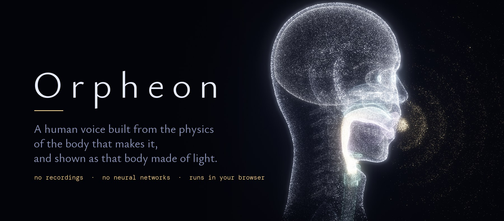</a>

<p align="center">
  <a href="https://orpheon.cutiemirror.com/"></a>
  <a href="#listen"></a>
</p>
<p align="center">
  <a href="LICENSE"></a>
  
</p>

<p align="center">
  <a href="#listen">Listen</a> ·
  <a href="#2-the-model">How it works</a> ·
  <a href="#3-validation">Validation</a> ·
  <a href="#4-the-body-of-light">The body of light</a> ·
  <a href="#7-running-it">Run it</a> ·
  <a href="#references">References</a>
</p>

<p align="center">
  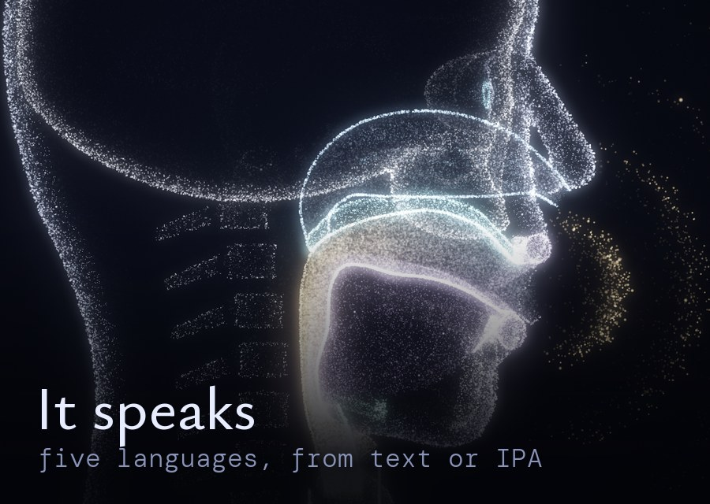
  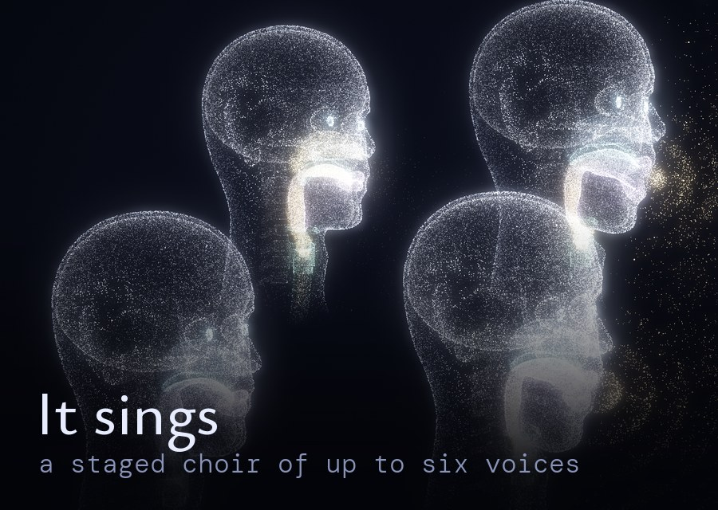
  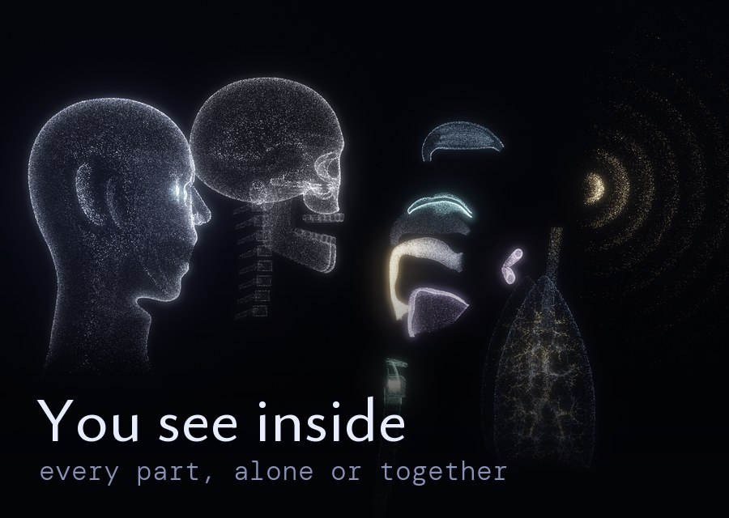
</p>

---

> **Abstract.** Orpheon is a singing and speaking voice synthesizer that contains no recordings
> and no neural networks. It simulates the parts of the body that make a voice. Breath from the
> lungs pushes air through a pair of vocal folds, which chop the flow into pulses. Those pulses
> ring in a 48-section acoustic tube that the tongue, jaw, lips and soft palate reshape every
> millisecond. Sound then leaves through the mouth and a side branch for the nose. Its physical
> constants come from, or are fitted to, published measurements of real speakers. Across 21
> vowels and three body sizes, the synthesized formants land within **0.7–1.7 % (mean)** of the
> published averages. The same simulation drives a real-time WebGL2 view of the head as about
> **half a million particles**. The tongue is drawn where the airway model says it is, the air
> glows where the standing wave is loud, and the eyes blink. Orpheon runs entirely in the browser
> in plain TypeScript with no runtime dependencies. It speaks five languages plus raw IPA, sings
> MIDI files as a staged choir of up to six voices, and plays them with a band of twelve
> physically modelled instruments.

<p align="center">
  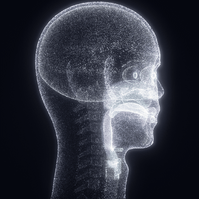<br>
  <sub><b>Figure 1.</b> Six seconds of the simulation, frame by frame: the voice runs through /a i u s a m a t a ʃ i n/.
  Everything that moves is driven by the voice's own state. The eyes blink on their own.</sub>
</p>

## Listen

Everything below came out of Orpheon as it is in this repository. No sound was recorded, and
nothing was edited afterwards except trimming silence and setting the loudness. GitHub cannot
play sound inside a README, so each sample opens in your browser.

<p align="center">
  <a href="https://orpheon.cutiemirror.com/samples/demo.mp4">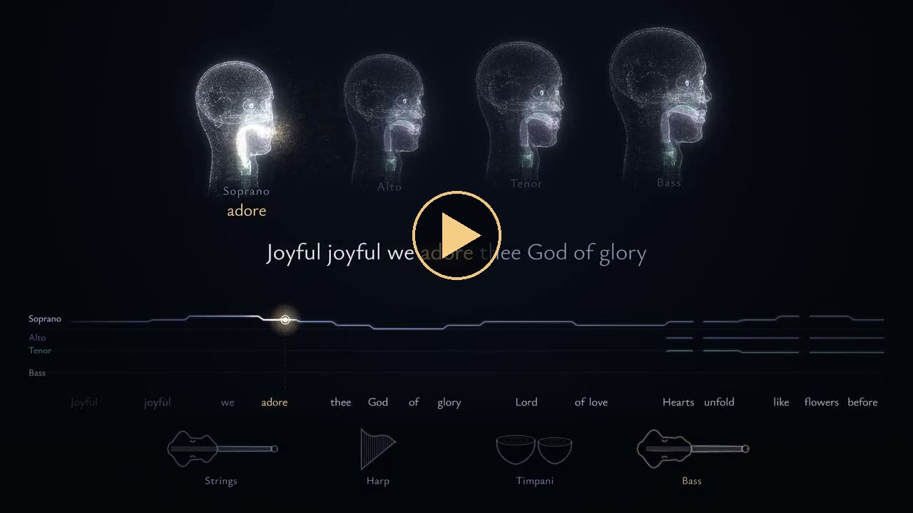</a><br>
  <sub><b>Video 1.</b> <a href="https://orpheon.cutiemirror.com/samples/demo.mp4"><b>Watch with sound (45 s, 4.4 MB)</b></a>: a choir of four simulated
  bodies sings <i>Ode to Joy</i> (words: Henry van Dyke, 1907), with strings, harp, timpani and bass. The page's own
  Video button made it, faster than real time.</sub>
</p>

<p align="center">
  <a href="https://orpheon.cutiemirror.com/samples/speak-tenor.mp3">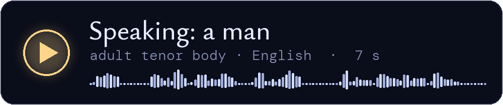</a>
  <a href="https://orpheon.cutiemirror.com/samples/speak-soprano.mp3">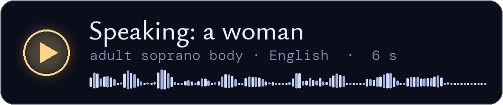</a>
  <a href="https://orpheon.cutiemirror.com/samples/speak-child.mp3">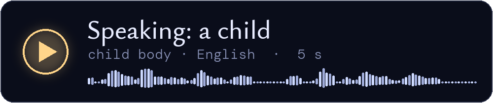</a>
  <a href="https://orpheon.cutiemirror.com/samples/sing-vowels.mp3">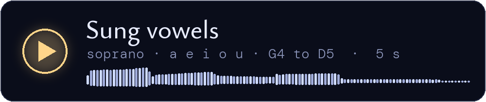</a>
  <a href="https://orpheon.cutiemirror.com/samples/sing-twinkle-solo.mp3">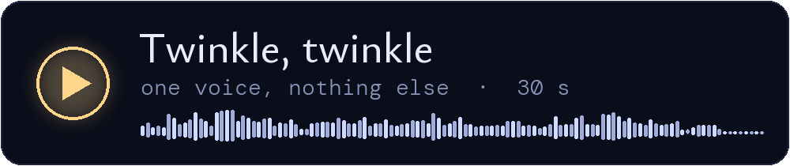</a>
  <a href="https://orpheon.cutiemirror.com/samples/sing-joy-choir.mp3">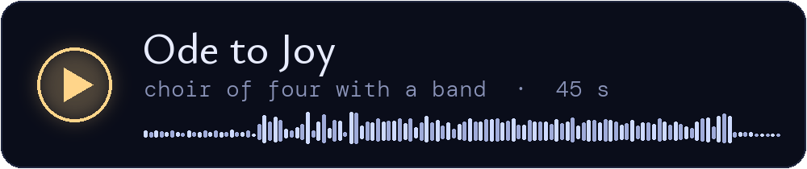</a>
  <a href="https://orpheon.cutiemirror.com/samples/sing-jacques-round.mp3">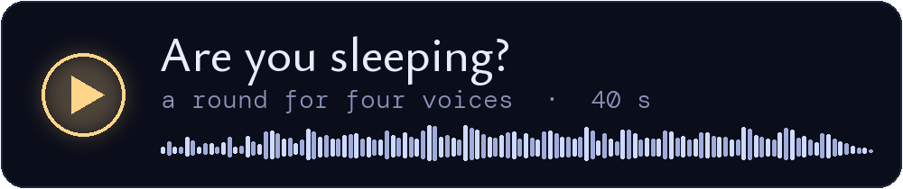</a>
  <a href="https://orpheon.cutiemirror.com/samples/sing-old100-hymn.mp3">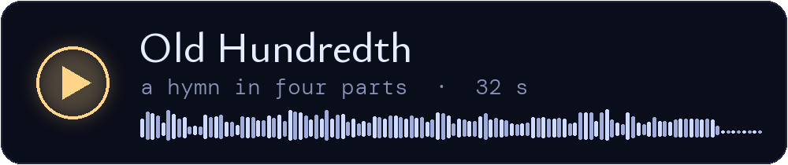</a>
</p>

The speech was typed as text and spoken through the English front end. The songs are the page's
own WAV export (voices, band, room and limiter), and every song is in the public domain. To check
how clear the speech is, [Whisper](https://github.com/openai/whisper) (`small.en`) transcribed
each spoken line. Its mistakes are shown as they are:

| Body | What Whisper heard | Missed |
|---|---|---|
| Man | “Hello, I am a voice made of air, flesh and light, nothing you hear was ever recorded.” | none |
| Woman | “Every sound starts in **full** small folds, deep in the throat, and **deep** through the lips.” | *two*, *leaves* |
| Child | “A smaller body has a **shoulder** throat, so its voice is higher and brighter.” | *shorter* |

<sub>Every card opens its MP3 in the browser. The files are in [`public/samples/`](public/samples), made by `tools/readme/samples.ts`.</sub>

## Contents

1. [Why a body?](#1-why-a-body)
2. [The model](#2-the-model): folds · tube · shape · noise · nose · sample rate · performance
3. [Validation](#3-validation): vowels · intelligibility · spectrograms · invariants
4. [The body of light](#4-the-body-of-light)
5. [Language and music](#5-language-and-music)
6. [The instrument](#6-the-instrument)
7. [Running it](#7-running-it)
8. [Limitations and future work](#8-limitations-and-future-work)
9. [Citing](#9-citing) · [References](#references) · [Licence](#licence)


---

## 1. Why a body?

Most synthetic voices today either replay pieces of recorded speech or predict sound with a
neural network trained on hours of it. Both can sound excellent, but neither can tell you *why* a
voice sounds the way it does. Neither can show you the tongue that makes an /i/, or let you drag
that tongue and hear the vowel change.

Orpheon takes the older route, **articulatory synthesis**, and builds the whole chain from
physics:

- **No samples.** Every sound is computed from air pressure and flow.
- **No training.** The physical constants are published measurements or fitted to them, and the
  paper is cited in the code where it is used.
- **Visible.** The picture on screen is drawn from the model's state, so you can watch what
  makes each sound.
- **Deterministic.** Its noise is seeded: at a given sample rate, the same input gives the same
  output, sample for sample, at any block size.

---

## 2. The model

### 2.1 Overview

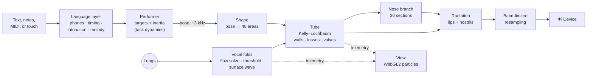

A **score** (timed phones with pitch) or a live **pose** goes in. A **performer** turns it into
targets for 15 pose values (lungs, pitch, glottis, register, larynx, jaw, tongue body, tongue
tip, lips, rounding, velum and more), and each moves toward its target with its own inertia.
Every 16 simulation samples (about a third of a millisecond), the **shape** model turns the pose
into the cross-sectional areas of the airway. The **folds** and the **tube** then run sample by sample at the tube's own rate, and a
**resampler** delivers the device's rate. Alongside the audio, the voice reports **telemetry**
(the area function, pressures, flows, fold opening), and the view draws exactly that.

### 2.2 Lungs and vocal folds

The flow through the glottis is solved every sample, in the one-equation form of Titze (1984)
[[22]](#references) built on Ishizaka & Flanagan (1972) [[9]](#references). The pressure drop
across the folds is shared between a Bernoulli term, the viscous drag of a slit, and the inertia
of the plug of air in the gap:

$$
P_\text{lung} - p_\text{above} \;=\; \underbrace{\frac{k\,\rho}{2}\left(\frac{U}{A_g}\right)^{2}}_{\text{Bernoulli}}
\;+\; \underbrace{\frac{12\,\mu\,d\,L^{2}}{A_g^{3}}\,U}_{\text{viscous slit}}
\;+\; \underbrace{\frac{\rho\,d}{A_g}\,\frac{dU}{dt}}_{\text{air inertia}}
$$

Here $U$ is the volume flow, $A_g$ the glottal area, $L$ the fold length, $d$ its thickness,
$\rho$ and $\mu$ the density and viscosity of warm, humid air, and $p_\text{above}$ comes from the
wave arriving back from the tube. The equation is quadratic in $U$ and is solved in closed form,
so the pulses lean and ripple with the tract's resonances, as real glottal flow does.

The folds vibrate only while the transglottal pressure exceeds a **phonation threshold** that
rises with pitch (Titze 1988, 1992 [[23](#references), [24](#references)]):

$$
P_\text{th} \;\approx\; 0.14 + 0.06\left(\frac{F_0}{F_{0n}}\right)^{2}\ \text{kPa},
\qquad
\text{amplitude} \;\propto\; \sqrt{P - P_\text{th}}
$$

It rises steeply if the folds are held apart or squeezed together. The folds stop more slowly
than they start (Lucero 1999). Each fold's edge follows Titze's surface-wave picture: the lower
lip opens first and the opening rolls upward (the mucosal wave). The gap along the fold follows a
string's first mode around a resting gap that widens toward the back.

*Pitch is steered, not emergent:* the cycle is a clock set to the requested F0, as an honest
trade. A mass–spring larynx drifts by several percent with breath and vowel, which a singer
cannot afford.

### 2.3 The airway as an acoustic tube

The vocal tract is cut into **48 slices of equal length**, from the folds to the lips. In each
slice a pressure wave travels toward the lips and another travels back. Where two slices of
different area meet, part of each wave passes on and part reflects. This is the scattering
junction of Kelly & Lochbaum (1962) [[11]](#references):

$$
r_k = \frac{A_k - A_{k+1}}{A_k + A_{k+1}},\qquad
\begin{aligned}
p^{+}_{k+1} &= (1+r_k)\,p^{+}_{k} - r_k\,p^{-}_{k+1}\\
p^{-}_{k}   &= r_k\,p^{+}_{k} + (1-r_k)\,p^{-}_{k+1}
\end{aligned}
$$

Even and odd junctions take turns, so one simulation sample is two half-steps. Physics the
lossless tube lacks is added on top:

| Effect | How it is modelled | Source |
|---|---|---|
| **Yielding walls** | a mass–spring–damper patch at every even junction; sets the closed-mouth resonance near 180 Hz | Fujimura & Lindqvist 1971; Ishizaka, French & Flanagan 1975 [[7](#references), [10](#references)] |
| **Viscous and thermal loss** | a little of the flow is taken at every odd junction, scaled by the slice's radius | Flanagan 1972 [[6]](#references) |
| **Valves** | wherever the tube is narrow, the pressure across the gap follows Bernoulli, $\Delta p = \tfrac12\rho(u/A)^2$, plus slit drag. This is what lets pressure build behind a closure | Stevens 1998 [[20]](#references) |
| **Turbulence** | noise is injected wherever the Reynolds number exceeds a critical value | §2.5 |
| **Nose** | a 30-section side branch joining at the velar port, open as far as the velum lets it | Dang, Honda & Suzuki 1994 [[4]](#references) |
| **Radiation** | lips and nostrils open into free air like a piston in a wall | Flanagan 1972 [[6]](#references) |

### 2.4 Shaping the tube

The shape model works on the gap between the tongue and the wall opposite it, as seen in a side
view of the head. It turns that gap into an area with the power law Heinz & Stevens (1965)
[[8]](#references) fitted to X-ray tracings:

$$
A(x) \;=\; \alpha\; g(x)^{1.5}
$$

The tongue keeps its volume. Bunched forward it leaves the throat wide (/i/); pulled back, it
leaves the mouth wide (/a/, /u/). It hangs from the jaw, so an open jaw also swings its root back
into the throat. A second, narrow hump makes the tongue tip, and the lips are the last two
slices: rounding narrows them and lengthens the tube.

<p align="center">
  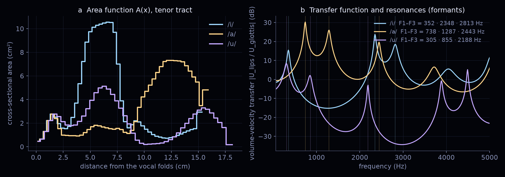<br>
  <sub><b>Figure 2.</b> (a) The area function the shape model produces for the corner vowels /i a u/ in a tenor's
  16.8 cm tract. (b) The tube's transfer function for each, computed in the frequency domain by the transmission-line
  method of Fant (1960) [<a href="#references">5</a>]. The peaks are the formants that give each vowel its identity.
  Both panels come straight from the engine's own code (<code>tools/readme/data.ts</code>).</sub>
</p>

### 2.5 Noise: whispers, hisses and breath

Air forced through a narrow gap fast enough turns turbulent. The noise source at each valve
grows with the square of the Reynolds number above a critical value (Cherry 1969; Meyer-Eppler
1953 found $Re_c \approx 1800$ for fricatives):

$$
\text{noise} \;\propto\; Re^{2} - Re_c^{2},\qquad Re = \frac{\rho\,u\,h}{\mu}
$$

The noise is louder where the jet strikes an edge (the upper teeth, after Shadle 1985
[[19]](#references)). The same mechanism gives /s/ and /ʃ/ their hiss, /h/ its breath, and a
breathy voice its air.

### 2.6 Any sample rate

A shorter tract means shorter slices, and so a faster simulation:

$$
f_\text{sim} = \frac{N}{2}\cdot\frac{c}{L}\qquad(N = 48,\; c \approx 350\ \text{m/s})
$$

That is about 45 kHz for a bass and 75 kHz for a child, and it drifts as the larynx and lips
move. Each device sample is read out of the recent simulation samples through a windowed sinc
(the band-limited interpolation of Smith & Gosset 1984 [[21]](#references)), with its cutoff
below half the lower of the two rates. The voice therefore stays stable anywhere from 8 kHz (a
Bluetooth headset) to 192 kHz.

### 2.7 Performance: from a score to movement

Speech is not a sequence of poses but overlapping gestures. Following Öhman (1966)
[[16]](#references), the vowels flow into each other underneath, and each consonant borrows only
the articulators it needs, for as long as it needs them. Each articulator is a mass on a
critically damped spring (the task-dynamic model of Saltzman & Munhall 1989 [[18]](#references)),
fast for the tongue tip and slow for the jaw:

$$
\ddot{x} \;=\; -2\omega\,\dot{x} \;-\; \omega^{2}\,(x - x_\text{target})
$$

The time constants come from Löfqvist & Gracco (1997) for the lips and jaw and Kuehn & Moll
(1976) for the tongue and velum [[12](#references), [13](#references)]. Because a part needs time
to get anywhere, every target is set early by exactly that time: what a listener hears as the
start of a sound lands on its scheduled instant. Voice-onset times follow Lisker & Abramson
(1964) [[14]](#references).

---

## 3. Validation

The voice is measured, not just listened to.

### 3.1 Vowels against published measurements

Each vowel's articulatory pose is fitted by search (`tools/voice-fit-vowels.ts`) so that the
formants measured *from the rendered audio* match published averages. The targets come from
Hillenbrand et al. (1995) for American English vowels and Peterson & Barney (1952) for the rest
[[3](#references), [17](#references)].

<p align="center">
  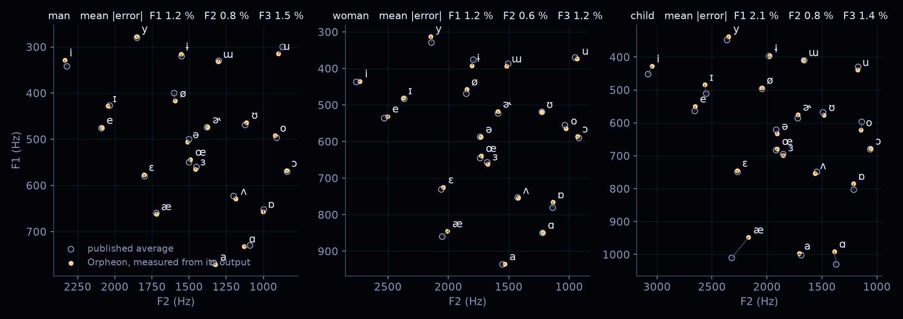<br>
  <sub><b>Figure 3.</b> The vowel space for a man, a woman and a child. Hollow circles are the published averages, gold dots
  what Orpheon actually produces, and the line between them is the error. Mean absolute error over all 63 fitted
  vowel–body pairs: <b>F1 1.7 %, F2 0.7 %, F3 1.3 %</b>; the largest single miss is 6.6 %.</sub>
</p>

### 3.2 Intelligibility

A speech recognizer that has never heard Orpheon (Whisper small.en, run offline) writes down
what it hears, and the score is the fraction of words that come back in order. The tests live
in `tools/` and are never tuned. A held-out part of the story is never used during development,
so it measures generalization, not memorization.

| Test | What is said | Orpheon (tenor) | Studio voice, same test |
|---|---|---:|---:|
| `voice-judge.ts` | sentences and single words | **86.6 %** | n/a |
| `voice-story.ts`, tuning part | a real narration, first paragraph | **83.5 %** | 99.2 % |
| `voice-story.ts`, held-out part | the rest of the narration, never tuned against | **84.6 %** | n/a |
| `voice-pairs.ts` | minimal pairs (*sea/she, no/low, wet/let…*) after a fixed carrier, after the Modified Rhyme Test | **39.1 %** | 96.2 % |

<sub>Measured 2026-11-15 on the current voice code. The studio voice is a commercial neural TTS reading the same text,
used as the ceiling of what the listener can understand.</sub>

The story score says most connected speech gets through, though a studio voice still does
clearly better. The pairs score says where the work is: some consonant contrasts (/n/ vs /l/, /r/ vs /l/, /w/ vs /r/) are still too alike. See
[§8](#8-limitations-and-future-work).

### 3.3 What it sounds like

<p align="center">
  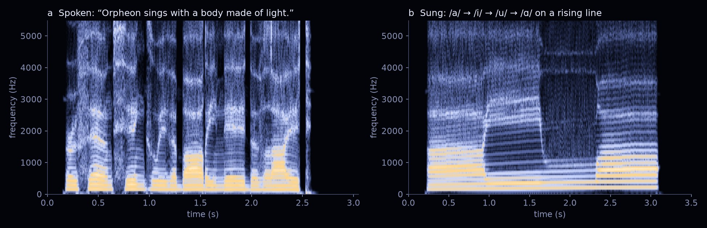<br>
  <sub><b>Figure 4.</b> Spectrograms of Orpheon's raw output. (a) A spoken sentence: formant transitions, stop bursts,
  the hiss of /s/ and /ʃ/. (b) Four sung vowels: the harmonics of the voice, and the formants of each vowel lifting
  different harmonics. Made with <code>tools/render.ts</code>.</sub>
</p>

### 3.4 Engineering invariants

**1302 tests** across voice, language, band, view and video keep the following true:

- **No allocation while rendering.** Six voices and a band share one audio thread.
- **Block-size independence.** Rendering 128 samples at a time or 4096 gives the same samples.
- **Any sample rate** from 8 kHz to 192 kHz, without NaN, for every body and every instrument.
- **Determinism.** All noise is seeded (xorshift, Marsaglia 2003).
- **Tube theory agreement.** The time-domain tube's resonances match the frequency-domain
  transmission-line solution (`src/voice/theory.ts`).

---

## 4. The body of light

The head is not drawn: it is a cloud of about **516,000 particles** that holds the shape of a
head. Every part inside it is its own cloud and can be shown alone. The particles are made once
in a Web Worker and never rewritten. Each frame, the voice's telemetry becomes one small texture
(the airway, nose and soft palate as they are this instant), and the vertex shader moves every
particle from it.

- **What you see is what you hear.** The tongue's surface is where the simulated tube says it
  is. The bright bands in the air column are the real standing wave. The folds are drawn as a
  stroboscope shows them, and sound leaves the lips as rings spaced by the pitch.
- **Cold matter, warm sound.** Tissue is cold starlight. Warmth appears only where there is
  acoustic energy or airflow: dust, then gold, then white.
- **Light, not paint.** Particles add their light together, and shells are bright where they are
  seen edge-on, so the head reads as glass.

<p align="center">
  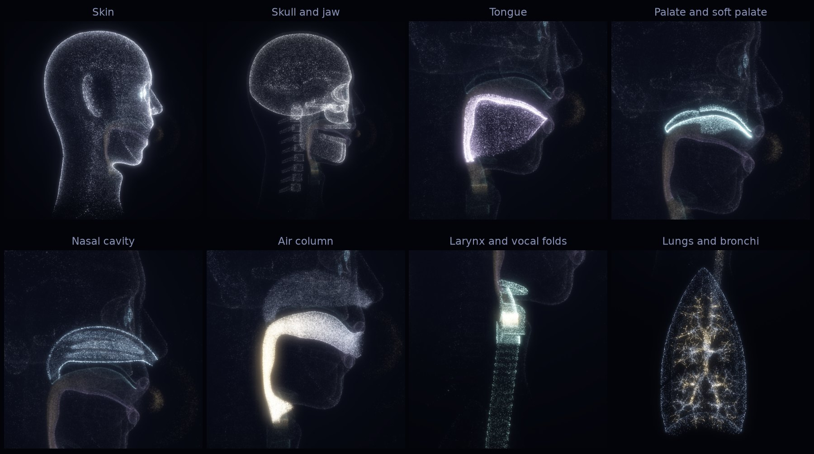<br>
  <sub><b>Figure 5.</b> Every part can be shown alone, the rest left as a ghost. All are anatomical layers of one
  simulation and move together.</sub>
</p>

<p align="center">
  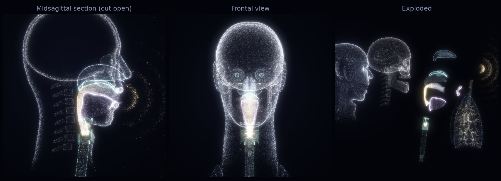<br>
  <sub><b>Figure 6.</b> Cut open down the midline, seen from the front, and pulled apart. The section is the view
  phoneticians draw; here it moves.</sub>
</p>

### 4.1 Density and colour

Every viewer can choose how thick the cloud is and how colourful. Thinning the cloud sheds
particles; thickening it draws up to 1.5 times the default. Colour moves each part from its cold
tint toward an anatomical hue that drifts slowly across the body, like light through glass.
Sound still heats toward gold and white.

<p align="center">
  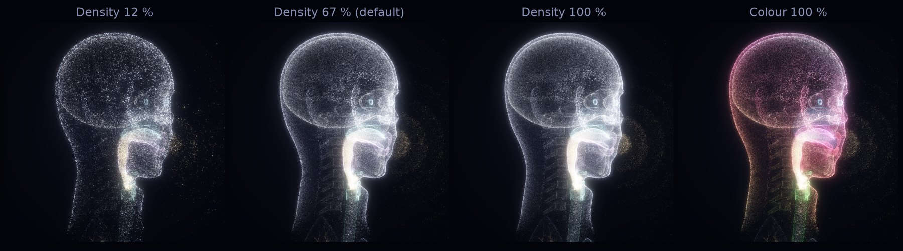<br>
  <sub><b>Figure 7.</b> Density at 12 %, 67 % (the default) and 100 %, and Colour at 100 %.</sub>
</p>

### 4.2 Eyes that blink

A face that never blinks looks lifeless, so this is the one movement not driven by the voice.
The blinks follow measured human blinking (Stern, Walrath & Goldstein 1984; Doane 1980): a
spontaneous blink every few seconds, sometimes two together. Each lasts about a third of a
second: the lid falls in ~75 ms, rests shut ~40 ms, and rises in ~200 ms. Between blinks the eyes
make small saccades and hold still (Bahill et al. 1975). Every singer in a choir blinks on its
own clock.

<p align="center">
  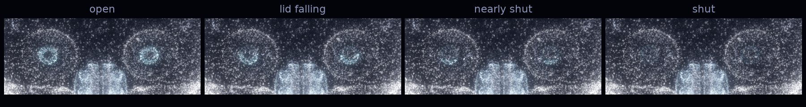<br>
  <sub><b>Figure 8.</b> One blink, seen from the front: the upper lid comes down over the iris.</sub>
</p>

---

## 5. Language and music

**Speech.** Text becomes timed phones through a front end for each language: **English** (the
CMU Pronouncing Dictionary plus letter-to-sound rules), **Spanish, Italian, Latin, Japanese**, and
raw **IPA**. Durations follow the shape of Klatt's rules (1979) [[25]](#references), and intonation
follows the tone model of Pierrehumbert (1980).

**Singing.** Lyrics are fitted to a tune phrase by phrase, a syllable to a note, the vowel
filling the note and the consonants fitted in around it. Vibrato swings at a trained
singer's 5–6 Hz (Sundberg 1987).

**MIDI and karaoke files.** Any `.mid` or `.kar` file can be imported. Orpheon finds the key with
the Krumhansl–Schmuckler method (Krumhansl & Kessler 1982), places the barlines (Lerdahl &
Jackendoff 1983), reads the phrases, and arranges the tune for a choir of up to six voices:

- a **staged plan** with entries, solos, duets in sixths, men alone, hums under a solo;
- a **critic** that scores up to 54 candidate plans and sings the best one;
- **Try another**, which steps through real alternatives.

**The band: twelve physically modelled instruments.** Each one is built like the voice and runs
in the same audio thread:

| | Instruments | Model |
|---|---|---|
| Strings | bass, strings, harp, guitar, sarod, esraj, tanpura | modal synthesis: exactly tuned decaying partials (Adrien 1991) |
| Keys | piano | hammer–string contact and coupled strings (Chaigne & Askenfelt 1994; Van Duyne & Smith 1994; Weinreich 1977) |
| Wind | flute | a jet across a pipe (Cook 1992) |
| Drums | timpani, tabla | modal; the tabla's loaded head rings in harmonics (Raman 1934) |
| Kit | drum kit | struck membranes and plates as their modes, with noise (Fletcher & Rossing 1998) |

The band is chosen per song, plays chords drawn from all sung lines, and sits 9–13 dB under
the tune. Each singer in a choir is its own simulation, with its own tract length and folds.

---

## 6. The instrument

<p align="center">
  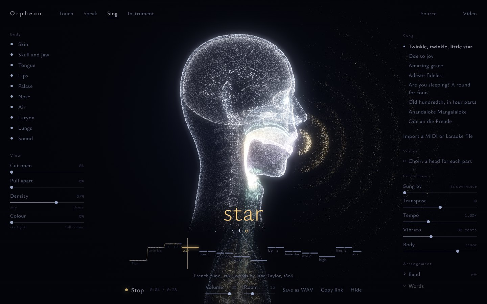<br>
  <sub><b>Figure 9.</b> The page, singing. Left: the body and how it is seen. Right: the current mode's controls.
  Bottom: the words, the piano roll and the transport.</sub>
</p>

| Mode | What you do |
|---|---|
| **Touch** | Play the body live: hold the vowel pad and move, play notes on the keyboard or a MIDI keyboard, move jaw, lips, soft palate, breath and voice quality, or drag the body itself. |
| **Speak** | Type in English, Spanish, Italian, Latin, Japanese or IPA. |
| **Sing** | Built-in songs, your own words to a tune, or any MIDI or karaoke file, solo or as a staged choir with a band. |
| **Instrument** | The voice as a polyphonic synth: presets from choir pad to overtone singing, unison, detune, a giant's or a child's airway. |
| **Video** | Records the performance as an MP4 (16:9, 9:16, 1:1, 4:5) with captions, five looks and a moving camera, rendered offline faster than real time. |

Everything renders to WAV, and every setting can be shared as a link.

<p align="center">
  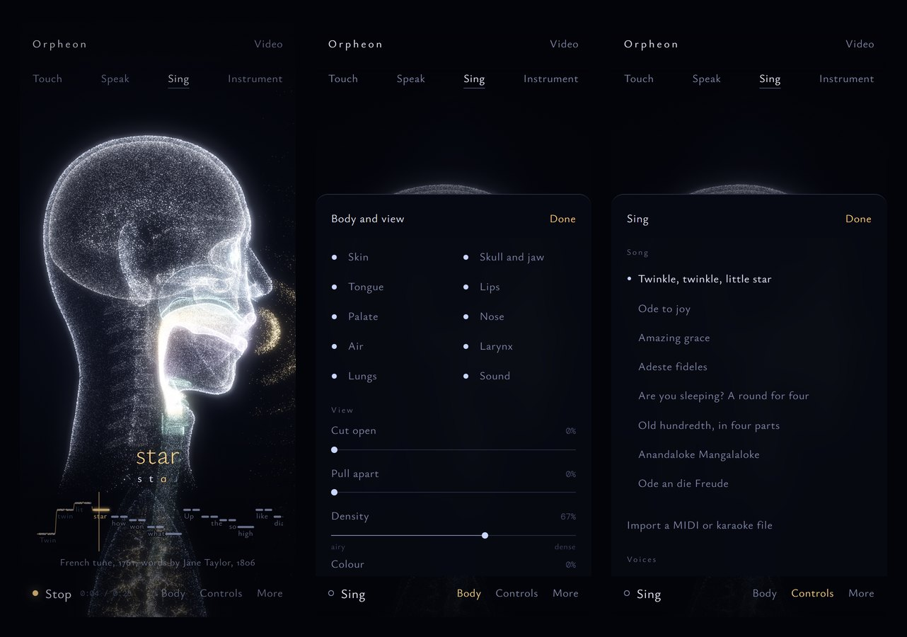<br>
  <sub><b>Figure 10.</b> On a phone: one row at the foot (the main button, then Body, Controls and More), each opening a sheet.</sub>
</p>

---

## 7. Running it

Requires [Bun](https://bun.sh).

```sh
git clone https://github.com/OuterSpacee/orpheon.git
cd orpheon
bun install
bun run dev          # http://127.0.0.1:5340/
bun test             # 1302 tests
bun run build        # a static site in dist/; host it anywhere
```

<details>
<summary><b>Project layout</b></summary>

| Folder | What it does |
|---|---|
| `src/contract.ts` | The shared vocabulary: the body's pose, a timed score, what the voice reports |
| `src/voice/` | The physics: folds, tube, shape, inertia, the performer, resampling |
| `src/lang/` | Words and notes into a score: pronunciation, timing, melody, MIDI, the arranger and its critic |
| `src/band/` | Twelve instruments, physically modelled |
| `src/view/` | The body as particles, moved by the voice's own state; the eyes |
| `src/app/` | The page: audio, controls, the modes, video export |
| `lab/` | A page for looking at the body alone (`lab/view.html?solo=tongue&cut=1…`) |
| `tools/` | Renderers, benchmarks, the speech judges, the figures in this README |
| `tests/` | `bun test` |
| `docs/look.md` | The art direction |

</details>

<details>
<summary><b>Reproducing the figures</b></summary>

Every figure in this README is generated from the engine:

```sh
bun run dev                                 # in one terminal
bun tools/readme/data.ts                    # tube shapes, transfer functions, vowel fit
bun tools/render.ts --say "Orpheon sings with a body made of light." shots/readme/speech.wav
bun tools/render.ts "ˈa:0.7 ˈi:0.7 ˈu:0.7 ˈɑ:0.7" shots/readme/vowels.wav --pitch "0:130,1.4:165,2.8:196"
bun tools/readme/shots.ts                   # renders of the body and the page
python tools/readme/figures.py              # draws docs/media/ (numpy, matplotlib, Pillow, ffmpeg)
bun run build && bun run preview            # then, in another terminal:
bun tools/readme/samples.ts                 # the sound and video samples in public/samples/
python tools/readme/cards.py                # the banner, tiles and sample cards (also fontTools, brotli)
```

</details>

<details>
<summary><b>Measuring the voice yourself</b></summary>

```sh
bun tools/render.ts --say "the quick brown fox" out/fox.wav    # any text to a WAV
bun tools/voice-bench.ts                                        # speed of each body
HF_HUB_OFFLINE=1 bun tools/voice-judge.ts                       # intelligibility (needs faster-whisper)
bun tools/voice-pairs.ts                                        # consonant contrasts
```

</details>

---

## 8. Limitations and future work

- **Consonant contrasts.** /n/, /r/ and /w/ are still often heard as /l/, and /s/ and /ʃ/ blur
  (§3.2). The next fixes, in order: the vowels of *go* and *say*, the third formant of /r/
  (2140 Hz against a measured 1840 Hz), and the length of /z/.
- **Pitch is steered.** F0 is a clock rather than the outcome of fold tension, so effects such as
  pitch breaks between registers are modelled, not emergent.
- **One airway per voice.** The tract is a 1-D tube with a side branch. Lateral channels (the
  sides of /l/) and the piriform sinuses are not separate paths.
- **The AI arranger is switched off.** An optional language-model adviser for imported files
  exists in `src/ai/` but needs a server. The public site is static, so every arrangement you
  hear is made by the deterministic arranger in the page.
- **The arranger** knows meters of 2, 3 and 4 and does not modulate on its own; the hand-written
  arrangements do.

Contributions are welcome: see [`CONTRIBUTING.md`](CONTRIBUTING.md).

---

## 9. Citing

```bibtex
@software{orpheon,
  author  = {OuterSpacee},
  title   = {Orpheon: an articulatory singing-voice synthesizer with a real-time anatomical view},
  year    = {2026},
  url     = {https://github.com/OuterSpacee/orpheon},
  license = {AGPL-3.0-or-later}
}
```

---

## References

Every model above is cited in the source where it is used. The main works:

1. Adrien, J.-M. (1991). The missing link: modal synthesis. In *Representations of Musical Signals*, MIT Press.
2. Bahill, A. T., Clark, M. R., & Stark, L. (1975). The main sequence, a tool for studying human eye movements. *Mathematical Biosciences*, 24.
3. Hillenbrand, J., Getty, L. A., Clark, M. J., & Wheeler, K. (1995). Acoustic characteristics of American English vowels. *J. Acoust. Soc. Am.*, 97(5).
4. Dang, J., Honda, K., & Suzuki, H. (1994). Morphological and acoustical analysis of the nasal and the paranasal cavities. *J. Acoust. Soc. Am.*, 96(4).
5. Fant, G. (1960). *Acoustic Theory of Speech Production*. Mouton.
6. Flanagan, J. L. (1972). *Speech Analysis, Synthesis and Perception* (2nd ed.). Springer.
7. Fujimura, O., & Lindqvist, J. (1971). Sweep-tone measurements of vocal-tract characteristics. *J. Acoust. Soc. Am.*, 49.
8. Heinz, J. M., & Stevens, K. N. (1965). On the relations between lateral cineradiographs, area functions and acoustic spectra of speech. *Proc. 5th Int. Congress on Acoustics*.
9. Ishizaka, K., & Flanagan, J. L. (1972). Synthesis of voiced sounds from a two-mass model of the vocal cords. *Bell System Technical Journal*, 51(6).
10. Ishizaka, K., French, J. C., & Flanagan, J. L. (1975). Direct determination of vocal tract wall impedance. *IEEE Trans. ASSP*, 23.
11. Kelly, J. L., & Lochbaum, C. C. (1962). Speech synthesis. *Proc. 4th Int. Congress on Acoustics*, G42.
12. Kuehn, D. P., & Moll, K. L. (1976). A cineradiographic study of VC and CV articulatory velocities. *J. Phonetics*, 4.
13. Löfqvist, A., & Gracco, V. L. (1997). Lip and jaw kinematics in bilabial stop consonant production. *J. Speech, Language, and Hearing Research*, 40.
14. Lisker, L., & Abramson, A. S. (1964). A cross-language study of voicing in initial stops. *Word*, 20.
15. Lucero, J. C. (1999). A theoretical study of the hysteresis phenomenon at vocal fold oscillation onset–offset. *J. Acoust. Soc. Am.*, 105.
16. Öhman, S. E. G. (1966). Coarticulation in VCV utterances: spectrographic measurements. *J. Acoust. Soc. Am.*, 39.
17. Peterson, G. E., & Barney, H. L. (1952). Control methods used in a study of the vowels. *J. Acoust. Soc. Am.*, 24.
18. Saltzman, E. L., & Munhall, K. G. (1989). A dynamical approach to gestural patterning in speech production. *Ecological Psychology*, 1(4).
19. Shadle, C. H. (1985). *The Acoustics of Fricative Consonants*. PhD thesis, MIT.
20. Stevens, K. N. (1998). *Acoustic Phonetics*. MIT Press.
21. Smith, J. O., & Gossett, P. (1984). A flexible sampling-rate conversion method. *Proc. IEEE ICASSP*.
22. Titze, I. R. (1984). Parameterization of the glottal area, glottal flow, and vocal fold contact area. *J. Acoust. Soc. Am.*, 75.
23. Titze, I. R. (1988). The physics of small-amplitude oscillation of the vocal folds. *J. Acoust. Soc. Am.*, 83.
24. Titze, I. R. (1992). Phonation threshold pressure: a missing link in glottal aerodynamics. *J. Acoust. Soc. Am.*, 91.
25. Klatt, D. H. (1979). Synthesis by rule of segmental durations in English sentences. In *Frontiers of Speech Communication Research*, Academic Press.

<details>
<summary>Further works cited in the code</summary>

Cherry 1969 (turbulence noise) · Meyer-Eppler 1953 (critical Reynolds number) · Pierrehumbert 1980 (intonation) ·
Perrier, Boë & Sock 1992 (sagittal-to-area) · Sundberg 1987; Sundberg, Titze & Scherer 1993 (singing) ·
Ladefoged & Maddieson 1996 (the trill) · Stern, Walrath & Goldstein 1984; Doane 1980 (blinking) ·
Krumhansl & Kessler 1982; Krumhansl 1990 (key finding) · Lerdahl & Jackendoff 1983 (metre) ·
van Noorden & Moelants 1999 (tempo) · Chaigne & Askenfelt 1994; Van Duyne & Smith 1994, 1995; Weinreich 1977 (piano) ·
Cook 1992 (wind) · Raman 1934 (tabla) · Fletcher & Rossing 1998 (instruments) ·
Schroeder 1962; Moorer 1979 (reverberation) · House et al. 1965 (the Modified Rhyme Test) · Marsaglia 2003 (xorshift).

</details>

---

## Licence

Copyright © 2026 OuterSpacee.

Orpheon is free software under the **GNU Affero General Public License v3.0 or later**
([`LICENSE`](LICENSE)). You may use, study, change and share it, including commercially. If you
run a modified version for others, over a network included, you must offer them its source under
the same licence. For a licence without these terms (for example, inside a closed product),
contact the author through GitHub.

**Credits.** Inspired by Jameson Hodge's
[chimera-vocal-synth](https://github.com/jamesondh/chimera-vocal-synth), which showed that a
simulated vocal tract can sing in a browser. Orpheon is a separate program written from scratch
and contains none of that project's code. English pronunciation comes from the
[CMU Pronouncing Dictionary](https://github.com/cmusphinx/cmudict) (its licence is in
`public/lang/`). The typefaces are Ysabeau and DM Mono, under the SIL Open Font License
(`public/fonts/`). The built-in songs are traditional or in the public domain; each one's source is in its credit line.
